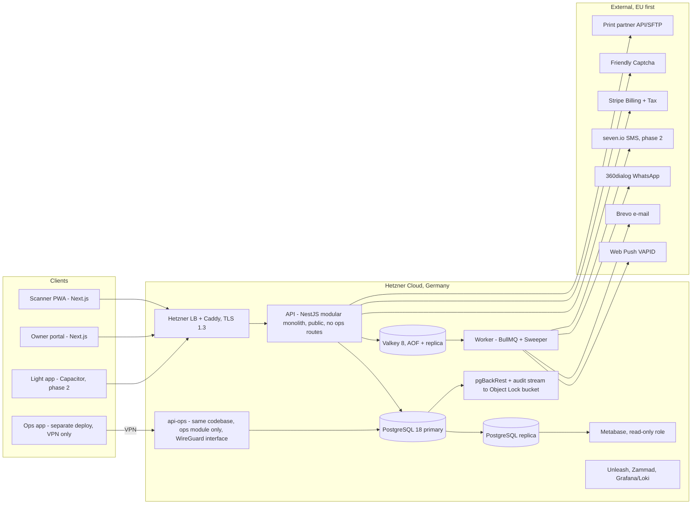
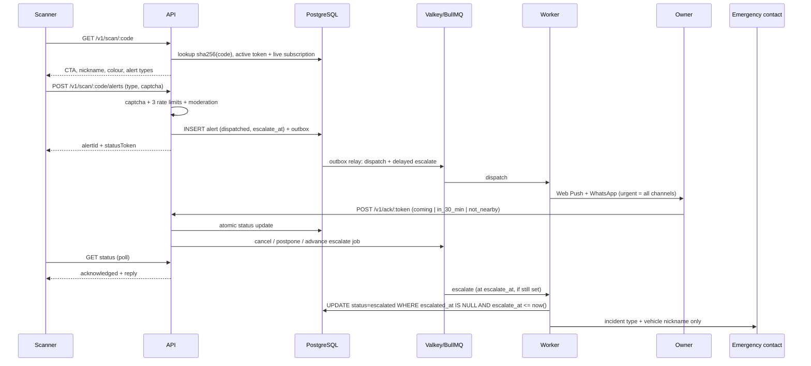
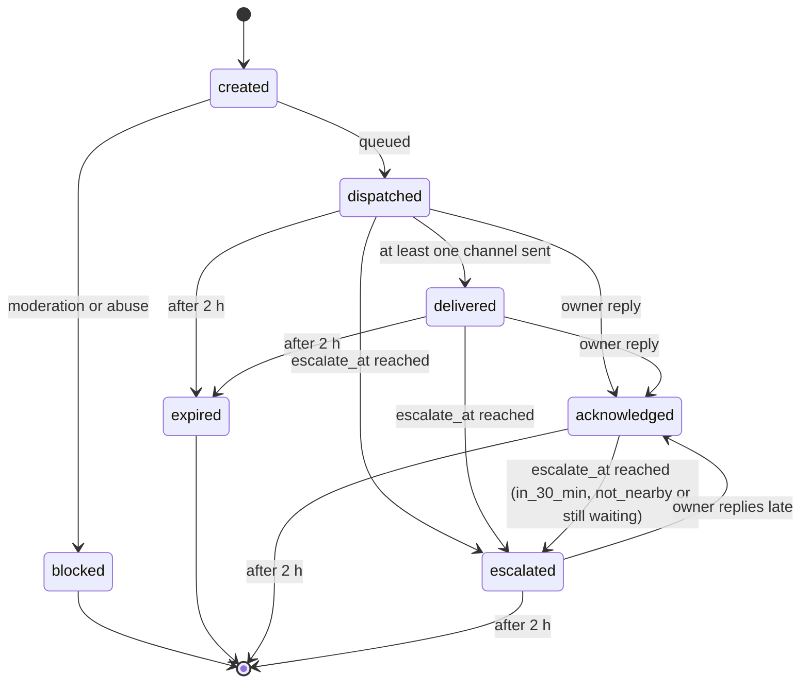

# 02 — Architecture, Data Model and Security

## 1. System overview



## 2. Technology decisions

Versions below are minimums. At Sprint 1, pin the latest stable major of each component (Next.js, NestJS, Valkey, etc.) and record it in an ADR.

| Layer | Choice | Reason / change in V3 |
|---|---|---|
| Frontend | Next.js 15 (App Router) + React 19 + Tailwind 4 | Scanner page server-rendered with minimal JS. *Changed:* the ops app is a separate app in the same monorepo, deployed on its own domain. |
| Backend | NestJS 11 modular monolith | Small team, single deploy. Modules (scan, alerts, notifications, escalation, billing, gdpr, ops) can be split later. The ops module has its own guard and permission checks. *Changed:* the ops module runs only in a separate `api-ops` deployment of the same codebase, listening on the WireGuard interface. The public API does not register ops routes, and Caddy on the public LB rejects `/ops/*` as a second layer. |
| Database | PostgreSQL 18 + streaming replica | Raw SQL migrations (dbmate); type-safe queries with Kysely. Schema runs in CI on real PostgreSQL 18. *Changed:* 18 instead of 16, which reaches end of life in Nov 2028, 15 months after launch. |
| Queues/cache | Valkey 8 + BullMQ | With AOF; the DB is the source of truth. *Changed:* monthly chaos drill. |
| Hosting | Hetzner Cloud (NBG1/FSN1) | 3–5× cheaper than AWS for the same size; German company. AWS Frankfurt is the documented fallback. |
| IaC | Terraform (hcloud) + Ansible + Docker Compose | k3s later if needed. |
| Secrets | SOPS + age in Git, or Infisical EU | Encryption keys never pass through CI in readable form. |
| Monitoring | Grafana + Prometheus + Loki (self-hosted), Sentry EU, Better Stack | Team alerts via Telegram or Slack. |
| Metrics *(new)* | Self-hosted Metabase | Instead of building a dashboard; saves ~40 h. |
| Feature flags *(new)* | Self-hosted Unleash | Gradual rollout and instant rollback without deploy. |
| Audit log *(new)* | Append-only table + live stream to Object Storage with Object Lock | Nobody with DB access can erase their trail. |
| Payments | Stripe Billing + Stripe Tax + Customer Portal | *Changed:* annual only. SEPA, cards, PayPal, Apple/Google Pay. No Klarna (instalments make no sense at €10). |
| Support | Self-hosted Zammad | *Changed:* only source of truth for tickets, plus sidebar widget. |
| Light app *(new)* | Capacitor (Phase 2) | Same frontend code; reliable native push on iOS. |

## 3. Alert flow

| # | From → To | Step |
|---|---|---|
| 1 | Scanner → API | `GET /v1/scan/K7QX4M2R9T`: look up `sha256(code)`, require an active token and live subscription. Returns CTA, vehicle nickname and colour, alert types, and "short stop" notice if set. |
| 2 | Scanner → API | `POST /v1/scan/:code/alerts`: captcha, then three rate limits, then content filter. |
| 3 | API → PostgreSQL | Insert alert with status `dispatched`, plus an outbox event, in one transaction. `escalate_at` is set only if the alert type escalates (`alert_types.escalates`) and a confirmed emergency contact exists; otherwise it is NULL. |
| 4 | Outbox → Worker | Dispatch job and delayed escalation job. Read limits and kill switches from settings. |
| 5 | Worker → owner & co-drivers | Push + WhatsApp (urgent = all channels). Every attempt recorded in `alert_deliveries`. |
| 6 | Owner → API | `POST /v1/ack/:token` with reply. One atomic `UPDATE` sets `status='acknowledged'`, `owner_reply` and `escalate_at`: `coming` → NULL; `in_30_min` → now + 30 min; `not_nearby` → now if escalation applies, else NULL. The escalation job is cancelled or rescheduled to match. A late reply after escalation is still accepted and shown to the scanner. |
| 7 | Scanner → API | Poll status every 3 s with `X-Status-Token` header. 15 min after acknowledgement "Ich warte noch" appears (`POST /v1/alerts/:id/waiting`, once): sets `scanner_waiting_at`, sends the owner one reminder with fresh reply buttons (NT-09) and, if escalation applies, moves `escalate_at` to at most now + 5 min (configurable). A reply to the reminder updates `escalate_at` as in step 6. |
| 8 | Worker → emergency contact | At `escalate_at`: `UPDATE alerts SET status='escalated', escalated_at=now() WHERE id=$1 AND escalated_at IS NULL AND escalate_at <= now() AND expires_at > now() AND status IN ('dispatched','delivered','acknowledged')`; only if a row changed, send incident type + vehicle nickname only. `escalate_at` is the single source of truth: replies only ever change it, so a stale job cannot escalate wrongly, and `escalated_at IS NULL` prevents double escalation. A sweeper runs every minute and re-schedules any overdue escalation. |



## 4. Alert states



- Escalation applies only to alert types with `alert_types.escalates = true` (`01-requirements.md` §1) and only if a confirmed emergency contact exists. It happens at most once per alert.
- Reply `in_30_min` keeps the alert `acknowledged` and sets `escalate_at` to now + 30 min.
- Reply `not_nearby` sets `escalate_at` to now, so the alert escalates within seconds. Without a confirmed contact, or for a type that does not escalate, it stays `acknowledged`; the scanner sees "Fahrer ist nicht in der Nähe" and the SC-13 guidance at once.
- After `expires_at` (2 h) polling stops and reply links stop working. Open alerts become `expired`; `acknowledged` and `escalated` remain as the final result.

## 5. Tokens, encryption and rate limiting

**Decal code.** 10 chars Crockford Base32 (50 bits). Stored three ways: SHA-256 (`code_hash`, used for every lookup), last 4 chars (`code_hint`, for support), and AES-256-GCM ciphertext (`code_enc`). The code is the only secret kept in recoverable form, because the home-print PDF, Wallet pass, reprints and pre-printed batch files must be re-rendered from it. Only the rendering and print-export jobs decrypt it; the ops app shows `code_hint` only. The URL is fixed and the decal never changes; "rotation" means revoking the code and printing a new decal. QR error correction level H. Guessing a valid code is impractical: 2⁵⁰ possible codes, the 404 limit per truncated IP, and 404-rate monitoring.

**Field-level encryption.** Format: `[key version 1B][IV 12B][tag 16B][ciphertext]` with AES-256-GCM. Equality lookups via blind index `HMAC-SHA256(key, normalize(value))`. Rotation: add `DATA_KEY_V2`, new writes use it, a background job re-encrypts old rows. Decryption from the ops app only via break-glass.

**Ack and status tokens.** 256 bits random; only the hash is stored. The ack token is single use and cleared on use. The status token lives only in the scanner's `sessionStorage`.

**Pseudonymous scanner references.** Two values, both computed on the server from the truncated IP and the User-Agent. Nothing is read from or stored on the device. Legal basis Art. 6(1)(f) — abuse protection.

- `scanner_ref = HMAC(daily_salt, ip_prefix | user_agent)` identifies the same scanner **across all vehicles for one day**. Used for rate limits, abuse patterns and same-day global blocks. The salt is random, generated each day, held only in Valkey and deleted when the day ends. It is never written to PostgreSQL or backups, so days cannot be linked. Column nulled after 24 h.
- `block_ref = HMAC(block_key, ip_prefix | user_agent | qr_token_id)` identifies the same scanner **for one vehicle only**. It is stored on the alert for 30 days so an owner's report can block that scanner for that vehicle for 30 days (OW-08). It cannot link a scanner across vehicles. `block_key` lives in the secrets store and rotates every 90 days; checks try the current and the previous key.

**Rate limits (Valkey keys).** Each check is one atomic Lua script: increment, set the TTL on the first hit, and if the result is over the limit, decrement and reject. Rejected requests therefore don't consume quota, and concurrent requests can't overshoot the limit.

| Key | Limit |
|---|---|
| `rl:st:{token}:{ref}` | 1 alert / 15 min per scanner per vehicle |
| `rl:sg:{ref}` | 6 alerts / hour per scanner across all vehicles |
| `rl:tg:{token}` | 20 alerts / 24 h per vehicle from everyone |
| `rl:404:{ip24}` | 30 not-found lookups / min per truncated IP |

## 6. Repository layout

```text
parkshield/
├── apps/
│   ├── web/      # Next.js: landing, scanner PWA (/s/[code]), owner portal
│   ├── ops/      # Next.js ops/admin app, separate deploy behind VPN
│   ├── mobile/   # (phase 2) Capacitor shell around the owner portal
│   └── api/      # NestJS: scan, alerts, notifications, escalation, billing, gdpr, ops (ops only in the api-ops deploy)
├── packages/
│   ├── shared/   # alert types, zod schemas, plan limits, permission codes
│   ├── ui/       # design system
│   └── i18n/     # de.json, en.json (ICU)
├── db/migrations/   # dbmate SQL; schema tested in CI on PostgreSQL 18
├── infra/
│   ├── terraform/   # hcloud servers, LB, firewall, volumes, object storage (+ Object Lock bucket)
│   └── ansible/     # hardening, docker, caddy, pgbackrest, metabase, unleash, zammad
├── e2e/          # Playwright
├── load/         # k6
├── chaos/        # monthly Valkey/worker failure drills
└── docs/         # these files, ADRs, runbooks
```

## 7. Environments

| Env | Purpose | Data | Deploy |
|---|---|---|---|
| Local | Development | Seed data | Docker Compose: Postgres, Valkey, Mailpit |
| Preview | Review each PR | Fake | Automatic per PR (frontend) |
| Staging | Demo, testing, monthly chaos drill | Fake; providers in sandbox | Automatic on merge to `main` |
| Production | Customers | Real | Manual by tag, weekly, with Unleash flags and rollback in minutes. Ops app deploys separately |

## 8. Data model

46 tables on PostgreSQL 18. Full SQL: [`../db/migrations/20261109000000_schema_v3.sql`](../db/migrations/20261109000000_schema_v3.sql). Lines marked `-- v3` are new or changed. **Run it in CI on PostgreSQL 18 (create tables + run `run_retention()`) before approving it.**

### 8.1 Schema conventions

- PKs are UUIDs (UUID v7 generated in the app; `gen_random_uuid()` as fallback).
- `*_enc` = AES-256-GCM ciphertext (bytea). `*_bidx` = HMAC-SHA256 blind index (bytea). `*_hash` = SHA-256 of a secret.
- `key_version` = which data key encrypted the row.
- No soft delete for personal data: GDPR erasure = hard delete or anonymisation.

### 8.2 Changes from V2

| Type | Tables | Purpose |
|---|---|---|
| New | `permissions`, `staff_roles`, `staff_role_permissions`, `staff_role_assignments` | Fine-grained staff permissions (AD-02). `user_role` replaced by `user_kind` |
| New | `break_glass_requests` | Four-eyes decryption, with a constraint preventing self-approval |
| New | `dsr_processor_steps` | One step per processor in GDPR requests |
| New | `partners`, `token_batches`, `promo_codes`, `promo_redemptions` | Partners, batches, promo codes, price lock |
| New | `refunds` | Withdrawals, refunds, credit notes |
| New | `app_settings`, `provider_status_events` | Settings without deploy, kill switches, provider health |
| New | `moderation_reviews` | Review of blocked-message samples |
| New | `vehicle_members`, `vehicle_transfers`, `vehicle_modes` | Co-drivers, transfer on sale, temporary modes |
| New | `business_waitlist` | Business waitlist |
| Changed | `users`, `sessions`, `push_subscriptions`, `qr_tokens`, `alerts`, `alert_deliveries`, `plans`, `subscriptions`, `decal_orders`, `data_subject_requests`, `audit_logs`, `scanner_blocks` | Quick replies, follow-up, scanner country, last scan/test, encrypted decal code and test window, per-vehicle `block_ref`, push platform (iOS KPI), plan availability, price lock, read events, append-only guard on audit log, `suppressed` delivery status |
| Removed | `support_tickets`, `ticket_messages` | Zammad is the source of truth; no duplicate personal data |

### 8.3 Table dictionary

| Group | Tables | Purpose |
|---|---|---|
| Identity | `users`, `webauthn_credentials`, `magic_link_tokens`, `sessions` | Passwordless login |
| Staff | `permissions`, `staff_roles`, `staff_role_permissions`, `staff_role_assignments`, `break_glass_requests` | Permissions and controlled decryption |
| Organisations | `organizations`, `organization_members`, `business_waitlist` | Business (coming soon) and waitlist |
| Channels | `contact_channels`, `push_subscriptions` | Where the owner receives alerts |
| Vehicles & codes | `vehicles`, `vehicle_members`, `vehicle_transfers`, `vehicle_modes`, `qr_tokens`, `token_batches` | Vehicle, its drivers, decal lifecycle |
| Escalation & rules | `emergency_contacts`, `notification_rules` | Consent, quiet hours, escalation delay |
| Alerts | `alert_types`, `alerts`, `alert_deliveries`, `alert_messages` | Alert, status, every attempt and its cost, chat |
| Abuse | `abuse_reports`, `scanner_blocks`, `moderation_reviews` | Reports, blocks, block review |
| Billing | `plans`, `subscriptions`, `usage_counters`, `promo_codes`, `promo_redemptions`, `refunds`, `partners` | Plans, subscription, limits, discounts, refunds |
| Shop | `decal_orders`, `decal_order_items` | Decal orders |
| Parking assistant | `parking_sessions` | Phase 2 |
| Compliance | `consents`, `data_subject_requests`, `dsr_processor_steps`, `audit_logs` | Consents, GDPR requests, audit trail |
| Operations | `app_settings`, `provider_status_events`, `outbox_events` | Settings, provider health, outbox pattern |

### 8.4 Staff roles (seeded)

| Role | Permissions |
|---|---|
| support | `customer.read_masked`, `alerts.read_metadata`, `pii.decrypt_request` |
| abuse_moderator | `customer.read_masked`, `abuse.moderate`, `moderation.review` |
| finance | `customer.read_masked`, `billing.refund`, `promo.manage` |
| fulfillment | `orders.manage`, `tokens.manage`, `pii.decrypt_request` |
| analyst | (Metabase read-only access, no ops permissions) |
| admin | all operational permissions incl. `pii.decrypt_approve`, `dsr.process`, `settings.edit`, `audit.read` |
| superadmin | `staff.manage`, `audit.read`, `pii.decrypt_approve`, `settings.edit` |

## 9. Security and abuse prevention

### 9.1 Threat model

| Threat | Scenario | Protection |
|---|---|---|
| Owner flooding | Photo of decal shared online, or sending from many devices | 3 rate limits, captcha, daily cap per code, report + block, automatic pattern alert (AD-08), one-click revoke |
| Text harassment | Insults, threats, sharing phone numbers | Rule filter (MVP) with false-positive measurement; EU classifier in Phase 2. Blocked messages never arrive |
| Fake decal / quishing *(new)* | Attacker sticks a fake QR on a car leading to a phishing page asking for payment | Domain `pkshd.de` printed next to the QR on the decal (check the camera's link preview), nickname/colour matching, "ParkShield verlangt nie eine Zahlung" on page and decal, report link, FAQ awareness |
| Owner tracking | Linking a decal to a person or address | No personal data on scanner page; nickname chosen by owner; no maps |
| Code guessing | Trying random codes | 50 bits, 404 limit per truncated IP, 404-rate monitoring |
| Account takeover | Phishing or e-mail theft | Passkeys, single-use 15-min magic link, e-mail on new-device login |
| Staff account compromise *(new)* | Stolen session or social engineering of support | Separate app behind VPN, passkey-only, 30-min sessions, masking by default, four-eyes break-glass, read logging, policy: support never changes e-mail or channels based on a phone call |
| Database leak | Breach or stolen backup | Encrypted fields, hashed tokens, encrypted backups (pgBackRest AES-256), keys outside the DB |
| Insider misuse | Staff browsing data | Fine-grained permissions, unerasable read log, quarterly review |
| DDoS | Flooding the scanner page | Hetzner DDoS protection, Caddy rate limit, lightweight cacheable page |
| Notification spoofing | Fake WhatsApp "from ParkShield" | Verified WhatsApp Business account, fixed domain, awareness |
| WhatsApp number restricted *(new)* | Meta quality rating drops due to reports | Monitor rating (AD-16), kill switch, Push and e-mail always on |

### 9.2 Mandatory practices

- TLS 1.3 only, HSTS preload, strict CSP. Portal session cookie `HttpOnly`, `Secure`, `SameSite=Lax`, plus CSRF tokens on state-changing requests. Not `Strict`: users following links from e-mails and notifications would appear logged out.
- Renovate, `npm audit` + OSV, Semgrep SAST in CI.
- No password logins on servers; SSH keys via WireGuard; Hetzner firewall opens only 443 to the LB.
- External pentest before launch and after each major phase. *New:* private bug bounty (EU platform such as Intigriti) after launch with a limited budget, plus `security.txt`.
- Incident response plan including notifying the supervisory authority within 72 h (GDPR Art. 33).
- *New:* quarterly review of staff permissions and break-glass requests.
- Monthly restore drill and monthly chaos drill.

## 10. Core API (MVP)

| Method & path | Description | Protection |
|---|---|---|
| `GET /v1/scan/:code` | Scanner page data (CTA, nickname/colour, types, back-at notice) | 404 limit per truncated IP |
| `POST /v1/scan/:code/alerts` | Create alert | Captcha, 3 rate limits, filter |
| `POST /v1/scan/:code/report-fake` *(new)* | Report a suspicious decal | Captcha + rate limit |
| `GET /v1/alerts/:id/status` | Alert status and quick reply | `X-Status-Token` header |
| `POST /v1/alerts/:id/waiting` *(new)* | "Ich warte noch" | `X-Status-Token`, once |
| `POST /v1/ack/:token` *(changed)* | Reply: `coming` / `in_30_min` / `not_nearby` | Single-use token, valid 2 h |
| `POST /v1/auth/magic-link` | Request login link | Captcha, 5/hour per e-mail |
| `POST /v1/auth/passkey/*` | Passkey registration and login | WebAuthn |
| `GET/POST/PATCH /v1/vehicles` | Manage vehicles | Owner session |
| `POST /v1/vehicles/:id/tokens` | Issue or revoke a code | Session + extra confirmation |
| `POST /v1/vehicles/:id/test-window` *(new)* | "Aufkleber testen": next scan within 10 min is a test (US-12) | Owner session |
| `POST/DELETE /v1/vehicles/:id/modes` *(new)* | Temporary modes | Owner session |
| `GET /v1/me/protection` *(new)* | Protection score | Owner session |
| `GET /v1/me/deliveries` *(new)* | "I didn't get the alert" page | Owner session |
| `POST/GET /v1/channels` | Channels and OTP | Owner session |
| `POST /v1/push-subscriptions` | Register a push device (with platform) | Owner session |
| `POST/GET /v1/emergency-contacts` | Invite an emergency contact | Owner session |
| `POST /v1/emergency-contacts/consent/:token` | Contact accepts or declines | Single-use token |
| `POST /v1/billing/checkout` *(changed)* | Annual Stripe Checkout with promo code | Owner session |
| `POST /v1/billing/cancel` | Cancellation button (§312k BGB) | Session, or e-mail + contract number |
| `POST /v1/business-waitlist` *(new)* | Business waitlist | Captcha + double opt-in |
| `POST /v1/webhooks/stripe`, `/v1/webhooks/whatsapp` | Payment events, message status, reply buttons | Provider signature |
| `POST /v1/me/export`, `DELETE /v1/me` | Export and delete | Fresh re-authentication |
| *All `/ops/v1/*` routes below are served only by `api-ops` on the VPN; the public API returns 404.* | | |
| `/ops/v1/customers/:id` *(new)* | Customer 360 (masked) | `customer.read_masked`, VPN, read logged |
| `/ops/v1/alerts/:id/trace` *(new)* | Delivery trace | `alerts.read_metadata` |
| `/ops/v1/break-glass` *(new)* | Request, approve, use | `pii.decrypt_request` / `pii.decrypt_approve` |
| `/ops/v1/dsr/*` *(new)* | GDPR requests and processor steps | `dsr.process` |
| `/ops/v1/refunds`, `/ops/v1/promo-codes` *(new)* | Refunds and promo codes | `billing.refund` / `promo.manage` |
| `/ops/v1/settings`, `/ops/v1/providers/health` *(new)* | Settings, kill switches, provider health | `settings.edit` |
| `/ops/v1/abuse/*`, `/ops/v1/moderation/*` | Abuse centre and block review | `abuse.moderate` / `moderation.review` |
