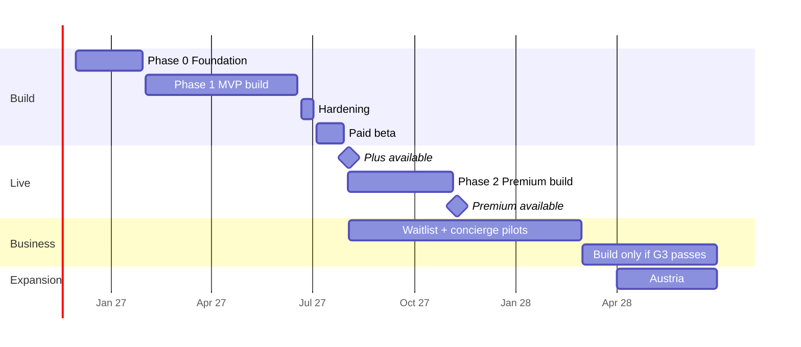

# 05 — Plans, Pricing, Economics, Roadmap and Risks

All prices are **per year**. Consumer prices include 19% VAT; costs and revenue figures are net. Variable provider prices are estimates and must be confirmed with real quotes in Phase 0.

## 1. Plans

No free tier, no trial. **Annual billing only**: at €10/year a monthly price would be below €1, and Stripe's fixed fee (~€0.25 per charge) would eat ~30% of it.

### Plus — €10/year (incl. VAT) · available at launch

For individual drivers.

- Up to 2 vehicles
- One UV-resistant vinyl decal included at first subscription, with shipping
- Home-print PDF at any time
- Web Push and e-mail unlimited; WhatsApp up to 10 messages/month
- "Ich komme", quick replies and live status for the scanner
- Escalation to 1 emergency contact
- 7 alert types and filtered free text
- Quiet hours and temporary modes
- Protection score and reminders
- 90-day history and abuse reporting
- E-mail support within 48 h

### Premium — €15/year (incl. VAT) · from Phase 2 (9 Nov 2027)

For families and people whose driveway is blocked often. Everything in Plus, plus:

- Up to 5 vehicles
- Up to 3 co-drivers
- WhatsApp up to 40/month; SMS fallback up to 5/month
- Masked calls up to 10 min/month
- Two-way anonymous chat with the scanner
- Multi-level escalation up to 3 contacts
- Scanner photo with automatic blurring
- Apple Wallet and Google Wallet
- Priority support within 24 h, incl. WhatsApp

### Business — coming soon ("Bald verfügbar")

No published price. For fleets, trades, delivery and rental companies. On the pricing page: a "coming soon" card with a waitlist form (company name, e-mail, fleet size) and double opt-in.

1. Collect the waitlist from launch day.
2. Run a manual concierge pilot for 3–5 companies on Premium accounts with manual invoices.
3. Build the plan and set the price only after gate G3 (Feb 2028).

### Plan limits (defaults in `plans.limits`; runtime overrides in `app_settings`)

| Limit | Plus | Premium |
|---|---|---|
| Vehicles | 2 | 5 |
| Emergency contacts | 1 | 3 |
| Co-drivers | 0 | 3 |
| WhatsApp / month | 10 | 40 |
| SMS / month | 0 | 5 |
| Masked-call minutes / month | 0 | 10 |
| Included decals (once) | 1 | 1 |

### Paid add-ons

| Add-on | Price | Note |
|---|---|---|
| Extra or replacement decal (UV vinyl) | €5.90 | Incl. shipping. Cost ~€2.40; margin ~€2.20 after fees |
| Upgrade included decal to NFC | €3.00 | Cost difference ~€1.40 |
| Extra NFC decal | €8.90 | Cost ~€3.80 |
| Laminated A6 dashboard card | €3.90 | For rental or shared cars |
| Extra vehicle above plan limit | €3/year | Plus and Premium |
| 25 SMS pack | €4.90 | Premium, when the limit is exceeded |
| Replacement after abuse wave or print defect | Free | Decided by abuse centre or support |

### Why these prices, and what they cost us

- **No-brainer purchase:** €10/year is less than any parking fine (€10–55) and far less than towing (€150–300).
- **Fits bulk distribution:** a property manager can buy subscriptions for a whole complex; a dealer can gift the first year with every car.
- **Clear upgrade step:** only €5 more for co-drivers, 5 vehicles, SMS and chat.
- **The cost:** much lower margin per customer, so we need roughly 2–4× more customers to break even than V2. Hence: no monthly billing, one included decal, lean fixed costs.
- **Perception risk:** a very low price can signal low quality. Mitigation: messaging focused on privacy and escalation (not "cheap"), and a high-quality decal.
- **Flexibility:** prices are tested in Phase 0 (€10, €15, €19). ParkShield may raise prices for new customers later, with a price guarantee for founding members.

## 2. Unit economics (per customer per year, EUR)

Year 1 carries the decal cost and higher early support; later years do not.

| Item | Plus Y1 | Plus Y2+ | Premium Y1 | Premium Y2+ |
|---|---|---|---|---|
| Price paid (incl. VAT) | 10.00 | 10.00 | 15.00 | 15.00 |
| Net revenue (after 19% VAT) | 8.40 | 8.40 | 12.61 | 12.61 |
| Decal, packaging, shipping | −2.40 | 0.00 | −2.40 | 0.00 |
| Payment fees (€0.25 + 1.5%) | −0.40 | −0.40 | −0.48 | −0.48 |
| WhatsApp (avg 6 / 12 msgs/yr × €0.055) | −0.33 | −0.33 | −0.66 | −0.66 |
| SMS and masked calls (avg usage) | 0.00 | 0.00 | −0.54 | −0.54 |
| Infrastructure share | −0.40 | −0.40 | −0.60 | −0.60 |
| Support share | −1.00 | −0.60 | −1.50 | −1.00 |
| Withdrawal/refund reserve (2%) | −0.17 | −0.17 | −0.25 | −0.25 |
| **Contribution margin** | **3.70 (44%)** | **6.50 (77%)** | **6.18 (49%)** | **9.08 (72%)** |

Add-ons: if 20% of customers buy one extra decal per year (margin ~€2.22), the average customer gains ~€0.44. For comparison, V2's Plus margin was €17.57/year.

- **Payment fees** assume EEA card pricing (1.5% + €0.25). SEPA Direct Debit and PayPal are priced differently, PayPal notably higher. Re-check with the real payment mix from the beta.
- **Overlap with fixed costs.** The infrastructure and support shares above also appear as lines in the fixed-cost table (§9). Treat the overlap (~€1.00–1.60 per customer per year) as a deliberate safety margin, and do not add further buffers for these items.

**Blended margin used in calculations** (70% Plus / 30% Premium, incl. add-ons):

| Metric | Value |
|---|---|
| Average margin, customer's first year | **€4.88** |
| Average margin, year 2 and later | **€7.71** |
| Add-on contribution per customer | ~€0.44 |
| Assumed medium-term Premium share | 30% |

## 3. Price scenario comparison

Same cost assumptions, year-2+ margin without add-ons, 70/30 mix. Use this for the price decision at gate G0.

| Scenario (Plus / Premium per year) | Plus margin | Premium margin | Blended | Break-even (lean launch costs) | Break-even (growth costs) |
|---|---|---|---|---|---|
| **€10 / €15 (V3, adopted)** | 6.50 | 9.08 | 7.27 | ~8,370 | ~24,750 |
| €19 / €29 (alternative to test) | 13.78 | 20.40 | 15.77 | ~3,860 | ~11,420 |
| €29 / €59 (V2) | 21.87 | 44.65 | 28.71 | ~2,120 | ~6,270 |

> **Reading:** €10/€15 needs roughly 4× the customers of €29/€59 to cover the same costs. That works only if the low price raises conversion and bulk distribution by at least that factor. The Phase 0 test must measure exactly this — not "will people accept €10?" (they will), but "how much higher is conversion at €10 than at €19?".

## 4. Break-even

| Cost stage | Fixed / month | Per year | Break-even at Y2+ margin (€7.71) | Break-even at Y1 margin (€4.88) |
|---|---|---|---|---|
| Lean launch (up to ~10k customers) | €5,072 | €60,864 | ~7,900 | ~12,500 |
| Growth (up to ~35k) | €15,000 | €180,000 | ~23,300 | ~36,900 |
| Scale (up to ~110k) | €45,000 | €540,000 | ~70,000 | ~110,600 |

The real figure lies between the two columns depending on the share of renewing customers. **Operating rule: do not move to a higher cost stage before exceeding the current stage's break-even at year-1 margin.**

Two break-even points are used, and only these:

- **Lean-stage break-even** (7,900–12,500 customers): reached in the base scenario around **Q1–Q2 2028**. Under the operating rule, growth-stage costs start only after ~12,500 customers (≈ Apr 2028, matching gate G4).
- **Company break-even** (monthly, at growth-stage costs, ~33k customers): expected in **Q4 2028** in the base scenario. This is the date used everywhere. It is borderline: at the forecast's actual 2028 Premium share (21%, not the 30% assumed above) and with ~85% of customers still in their first year, growth-stage break-even needs ~35k customers. Re-check at G4.

## 5. Revenue forecast

| End of | Base: customers | Net ARR | Conservative (40%): customers | Net ARR |
|---|---|---|---|---|
| 2027 | 4,700 Plus + 300 Premium = 5,000 | ~€43k | 1,880 + 120 = 2,000 | ~€17k |
| 2028 | 26,000 Plus + 7,000 Premium = 33,000 | ~€307k | 10,400 + 2,800 = 13,200 | ~€123k |
| 2029 | 60,000 Plus + 20,000 Premium = 80,000 | ~€756k | 24,000 + 8,000 = 32,000 | ~€302k |

ARR excludes add-ons and Business. In the conservative case the company stays in the lean cost stage through 2028 and reaches break-even end of 2028 or early 2029, provided costs are not raised. Business is unmodelled upside.

## 6. Development cost

Scenario A: nearshore team or freelancers at ~€45/h. Scenario B: German agency at ~€95/h. Excl. VAT.

### 6.1 Phase 1 (MVP) by module

| Module | Hours | A (€) | B (€) |
|---|---|---|---|
| Discovery, UX research, UI and design system | 160 | 7,200 | 15,200 |
| Architecture, infra, IaC, CI/CD, monitoring, backups, locked audit bucket | 120 | 5,400 | 11,400 |
| Account (magic link, passkeys), settings, i18n | 90 | 4,050 | 8,550 |
| Vehicles, codes, decal designer, print files | 110 | 4,950 | 10,450 |
| Scanner PWA, live status, captcha, accessibility, trust cues, guidance | 130 | 5,850 | 12,350 |
| Notification engine, quick replies, follow-up, kill switches | 160 | 7,200 | 15,200 |
| Acknowledge, escalation, contact consent | 90 | 4,050 | 8,550 |
| *New:* activation & retention (score, reminders, summary) | 40 | 1,800 | 3,800 |
| Anti-abuse with pattern alerts | 80 | 3,600 | 7,600 |
| Annual billing, promo codes, cancellation, withdrawal, dunning | 120 | 5,400 | 11,400 |
| Decal ordering and printer integration | 70 | 3,150 | 6,650 |
| *Moved:* parking assistant (to Phase 2) | 0 | 0 | 0 |
| GDPR features incl. identity verification and processor erasure | 100 | 4,500 | 9,500 |
| Ops app *(re-estimated, was 150 h)* | 300 | 13,500 | 28,500 |
| Support (help centre, Zammad widget, "didn't get the alert" page) | 50 | 2,250 | 4,750 |
| Landing page, SEO, legal pages, Business waitlist | 60 | 2,700 | 5,700 |
| QA (E2E, load, chaos, accessibility) | 190 | 8,550 | 18,050 |
| Project and product management | 160 | 7,200 | 15,200 |
| **Phase 1 total** | **2,030** | **91,350** | **192,850** |

### 6.2 By phase

| Phase | Hours | A (€) | B (€) |
|---|---|---|---|
| Phase 1: MVP with Plus | 2,030 | 91,350 | 192,850 |
| Phase 2: Premium (co-drivers, transfer, chat, SMS, calls, multi-escalation, Capacitor app, parking assistant, Wallet, NFC, scanner photo, AI assistant) | 1,130 | 50,850 | 107,350 |
| **Total through Phase 2** | **3,160** | **142,200** | **300,200** |
| Business (only if G3 passes): orgs, roles, schedules, API, B2B billing, partner portal | ~1,050 | ~47,250 | ~99,750 |

## 7. One-off setup costs (non-technical)

| Item | Cost (€) | Note |
|---|---|---|
| GmbH formation (notary, register) | 1,000 | Share capital is not a cost; UG is the cheaper alternative |
| Trademark: DPMA + EUIPO + similarity search | 2,140 | Classes 9, 38, 42 |
| Lawyer: AGB, privacy, processor agreements, DPIA, Widerruf/Wertersatz wording | 6,000 | IT-Recht specialist |
| DPO setup (VVT, TOMs) | 1,000 | |
| Pre-launch pentest | 7,000 | Includes the ops app and its permissions |
| Accessibility audit | 2,000 | BFSG |
| Visual identity | 3,000 | |
| Initial stock, print samples | 2,000 | 500 pre-printed decals for partners |
| Meta verification, WhatsApp setup, LUCID | 300 | |
| 15% contingency | 3,666 | |
| **Total** | **28,106** | |

## 8. Investment and funding

| Item | A (€) | B (€) |
|---|---|---|
| Phase 1 development | 91,350 | 192,850 |
| Setup costs | 28,106 | 28,106 |
| Running costs during build (6 × ~€1,000) | 6,000 | 6,000 |
| Launch marketing (first 3 months) | 15,000 | 15,000 |
| **Total to launch (3 Aug 2027)** | **140,456** | **241,956** |
| Phase 2 development (Premium) | 50,850 | 107,350 |
| Operating losses launch → break-even (Aug 2027 – Dec 2028, estimate) | ~70,000 | ~70,000 |
| **Total funding to break-even** | **~261,000** | **~419,000** |

With 5–10% buffer: **~€275–290k** in scenario A. The conservative scenario adds ~€60–80k of losses. (V2 estimated €190–210k but did not include Premium development.)

Possible sources: KfW ERP-Gründerkredit StartGeld (up to €125k), regional development banks (NRW.BANK, L-Bank), EXIST if university-linked, business angels, and a strategic partner (insurer or automobile club) pre-buying subscriptions in bulk.

## 9. Monthly fixed costs after launch (lean model)

| Item | Launch (≤ ~10k) | Growth (≤ ~35k) | Scale (≤ ~110k) |
|---|---|---|---|
| **Infrastructure (Hetzner)** | | | |
| App and worker servers | 32 | 100 | 400 |
| PostgreSQL primary + replica | 46 | 100 | 350 |
| Valkey, monitoring, Zammad, Metabase, Unleash | 42 | 80 | 180 |
| LB, storage, backups, Object Lock bucket | 26 | 60 | 180 |
| **Services and tools** | | | |
| Sentry, Better Stack, Plausible | 60 | 120 | 350 |
| Brevo, Friendly Captcha | 64 | 150 | 500 |
| WhatsApp BSP fixed fee | 49 | 99 | 300 |
| GitHub, Figma, Workspace, 1Password, Apple Developer | 118 | 200 | 400 |
| **Compliance and admin** | | | |
| External DPO | 250 | 350 | 700 |
| Tax adviser (Steuerberater) | 450 | 700 | 1,300 |
| Insurance, bank, IHK, legal texts | 135 | 200 | 600 |
| **Team and marketing** | | | |
| Development and maintenance (40 h → 1.2 FTE → 3.5 FTE) | 1,800 | 6,000 | 18,000 |
| Customer support (founders → working student → team) | 0 | 2,341 | 8,000 |
| Marketing and partnerships | 2,000 | 4,500 | 13,740 |
| **Monthly total (€)** | **5,072** | **15,000** | **45,000** |

Founders' salaries not included. At launch the founders handle support themselves on purpose — the best way to learn the real problems in the first months. Variable costs (messages, decals, payment) are in the unit economics.

### Variable cost per message/item

| Channel | Approx. cost | Note |
|---|---|---|
| Web Push | €0.00 | VAPID, no provider |
| E-mail (Brevo) | ~€0.0006 | Within monthly plan |
| WhatsApp (Utility template, Germany) | ~€0.055 | Meta per-message pricing; may change, so limits are editable in ops |
| SMS Germany | €0.075–0.09 | Phase 2 |
| Masked call | €0.02–0.04/min | Plus ~€1/month per pool number |
| Vinyl decal incl. packaging and postage | €2.40–2.60 | Print €0.90–1.10, stamp €1.10, packaging €0.20–0.40 |

## 10. Team

| Role | Time | Responsibility | Where to find |
|---|---|---|---|
| Product owner | 100% | Priorities, story acceptance, partners, legal, budget, **support in early months** | You or a co-founder |
| Tech lead (backend) | 100% | Architecture, NestJS, DB, security, code review, ops app | Malt, Toptal or nearshore agency; small paid trial task |
| Full-stack developer (Next.js) | 100% | Scanner page, portal, ops UI | Same sources |
| UX/UI designer | 50% then 20% | Research, prototypes, design system, decals | Freelancer with accessibility experience |
| QA | 50% | Test plans, Playwright, devices, chaos tests | Freelancer |
| DevOps | 20% | Terraform, Ansible, monitoring, backups, Metabase, Unleash, Zammad | Usually the tech lead |
| External | As needed | Lawyer, DPO, tax adviser, pentester, printer | IHK and local networks |

## 11. Phase 0, week by week (30 Nov 2026 – 29 Jan 2027)

| Week | Tasks | Output |
|---|---|---|
| 1 (30 Nov – 4 Dec) | Legal form, notary appointment, business bank account. Trademark similarity search. Register parkshield.de and pkshd.de. | Formation date, domains |
| 2 | File trademark at DPMA and EUIPO. Quotes from 3 lawyers and DPOs. Open Meta Business Manager. | Trademark filings, quotes |
| 3 *(changed)* | Landing page with waitlist (DOI) and **A/B/C price test**: €10, €15, €19 for Plus; measure sign-up rate per price. **Competitor analysis**: QR car-decal products in Europe and how we differ. Start 20 driver interviews. | Live page, competitor doc |
| 4 (holidays) | Small ads (€500) in Cologne and Berlin to measure interest per price. Write developer job specs. | Early data per price |
| 5 (4–8 Jan) | DPIA workshop with DPO; retention and consent design; *new:* staff permission and break-glass model. Technical interviews. | DPIA draft, permission model |
| 6 | Figma prototypes of scanner page (with trust cues), onboarding and protection score; test with 8 people (3 over 60). Print samples from two printers (UV and heat test). | Usability results, printer chosen |
| 7 *(changed)* | Sign contracts. Submit WhatsApp templates (with the three reply buttons). Open and verify Stripe. LUCID. **Talk to 5 property managers to secure 3 letters of intent for the beta.** First conversation with one insurer. | Contracts, templates in review, LOIs |
| 8 (25–29 Jan) | Gate G0 with **final price decision** based on the test. Backlog for sprint 1; GitHub and tooling set up. | Go decision and price |

## 12. Paid beta (5–30 Jul 2027)

- **Offer:** "Gründungsmitglied": €10/year with a **3-year price guarantee** and a special badge on the decal. Fully paid.
- **Recruiting:** waitlist, **property managers first** (decal bundles with partner promo codes), neighbourhood groups (nebenan.de), driving schools.
- **Measurement:** weekly survey, 20 interviews, daily delivery and acknowledgement metrics, activation funnel and iOS Push share from day one.
- **Strict rule:** no new features during the beta; fixes and polish only.

## 13. Go-to-market

With a first-year margin of ~€4.88, blended CAC must stay below €5. Bulk distribution and free channels first; paid ads only for testing.

| Channel | Execution | Target CAC |
|---|---|---|
| The decal itself | Every decal shows "ParkShield Protected" and a short link; scanner page shows "Auch schützen? parkshield.de". Free growth loop | €0 |
| **Property managers** (priority 1) | Pre-printed decal bundles for residents with a partner promo code, or bulk subscriptions for a complex. Solves blocked driveways in residential complexes | €2–4 |
| SEO content | German guides: "Zugeparkt – was tun?", "Parkscheibe Regeln" per city | €2–4 |
| Dealers, driving schools, rental firms | 20% commission on year one, or a first year gifted with every car (paid by the partner) | €2–3 |
| Referral *(changed)* | 3 extra months for both sides (instead of €5 off, which is now half the price) | ~€2 |
| Local press | Release: "Kölner Startup ersetzt die Handynummer hinter der Windschutzscheibe" | €0 |
| Social media | Short "zugeparkt" clips. Paid ads for testing only, < 10% of marketing budget | €6–12 |
| Insurers and automobile clubs *(new)* | Early talks in Phase 0; subscription bundled in their packages at wholesale price | ~€0 (B2B2C) |

## 14. Pre-launch checklist

- **Legal:** Impressum, AGB, Datenschutz, Widerruf reviewed by lawyer; AVVs signed with all processors; DPIA, VVT, TOMs documented; cancellation button tested; LUCID and trademark done.
- **Technical:** pentest with no open critical/high findings (incl. ops app); load test 200 alerts/s; successful restore and chaos drills; monitoring, on-call and status page; WhatsApp templates approved; audit log streaming to the locked bucket.
- **Operational:** decal stock and printer contract; 20 help articles and the "didn't get the alert" page; canned replies DE/EN; runbooks (WhatsApp failure with kill switch, DB outage, abuse wave, fake decals); staff roles assigned and reviewed.
- **Commercial:** final pricing page (€10 / €15 / coming soon); Business waitlist form works; press release; ≥ 3 signed property-manager partners; partner and referral codes ready.

## 15. Operations after launch

- **On-call:** scanner and notification paths monitored 24/7; alert if delivery < 98% or Meta quality rating drops.
- **Support:** founders in the early months. 48 h for Plus, 24 h for Premium.
- **Releases:** weekly with feature flags and instant rollback.
- **Security:** monthly restore drill, **monthly chaos drill**, weekly dependency review, quarterly permission review, private bug bounty.
- **Measurement:** weekly metrics review; monthly review of message cost, margin and activation funnel.

## 16. Roadmap (Dec 2026 – Jun 2028)

### Phases

| Phase | Period | Goal | Deliverables | Budget A / B |
|---|---|---|---|---|
| 0: Foundation | Dec 2026 – Jan 2027 | Prove demand, decide price, legal base, team | Company, trademark, DPIA, waitlist with price test, tested prototypes, printer, contracts, LOIs | ~€13k / €13k |
| 1: MVP | Feb – Jul 2027 | Sellable product: Plus | US-01 – US-45, pentest, beta | €91.35k / €192.85k |
| Launch | 3 Aug 2027 | Public launch in Germany | Campaign, press, partners | €15k marketing |
| 2: Premium | Aug – Nov 2027 | Higher revenue per customer, stronger differentiation, fix iOS | Co-drivers, transfer, chat, SMS, calls, multi-escalation, Capacitor app, parking assistant, Wallet, NFC, scanner photo | €50.85k / €107.35k |
| 3: Business | Coming soon: decision Feb 2028 | B2B revenue and distribution | Before decision: waitlist and concierge pilots. After: orgs, roles, schedules, API, B2B billing | ~€47k / ~€100k |
| 4: Expansion | From Apr 2028 | Nearby markets, same legal framework | Austria (OSS, same language, Austrian plates), then Netherlands and Belgium | ~€30k / €60k |

### Decision gates

| Gate | Date | Conditions to proceed | If not met |
|---|---|---|---|
| G0: start build | 29 Jan 2027 | ≥ 1,500 waitlist sign-ups. Conversion data per price (€10/15/19) available and final price decision written. €10 is kept only if its sign-up rate is ≥ 2.2× the rate at €19 (otherwise €19 reaches break-even sooner, see §3). Lawyer sees no blocker. Funding secured for ≥ 12 months. 3 property-manager LOIs. | Adjust message or price and retest 4 weeks, or cut scope |
| G1: public launch | 30 Jul 2027 | Delivery ≥ 99%. p95 scan→notify < 5 s. Acknowledgement ≥ 60%. Abuse < 2%. NPS ≥ 40. No critical/high vulnerabilities. ≥ 70% of beta members tested their decal. iOS Push share measured. | Extend beta 4 weeks |
| G2: release Premium | Oct 2027 | ≥ 2,500 paying customers. Refunds < 3%. CAC < €5. ≥ 25% want Premium features. ≥ 50% with complete protection. | Delay Premium; focus on activation and channels |
| G3: build Business | Feb 2028 | ≥ 30 companies on the waitlist totalling ≥ 150 vehicles. 3 successful paid concierge pilots. 3 active distribution partners. | Continue concierge; Business stays "coming soon" |
| G4: expand | Apr 2028 | ≥ 8,000 paying customers. Positive monthly contribution after launch-stage fixed costs. OSS registered. | Deepen the German market |

### Milestones

| Date | Milestone |
|---|---|
| 2026-12-11 | Company formed, trademark filed |
| 2027-01-29 | Gate G0, price decision, team contracts signed |
| 2027-02-26 | First sandbox payment at the new price |
| 2027-03-26 | First real alert from a printed decal |
| 2027-05-07 | Quick replies and escalation working end to end |
| 2027-06-18 | MVP feature-complete incl. ops app |
| 2027-07-02 | Pentest closed; ready for beta |
| 2027-08-03 | Public launch (Plus at €10) |
| 2027-11-09 | Premium launch at €15 and light app |
| 2027-12-31 | 5,000 paying customers |
| 2028-02-29 | G3 decision on Business |
| Q1–Q2 2028 | Lean-stage break-even (base scenario) |
| 2028-04 | Austria launch |
| Q4 2028 | Company break-even at growth-stage costs (base scenario) |

### Beyond 2028 (vision)

- Insurance partnerships: ParkShield bundled with car insurance; simplified damage claims from a "Schaden" alert with the owner's consent.
- Switzerland and UK: different privacy laws (revDSG, UK GDPR) and currency; left for 2029.
- Private parking and residential garages: codes for the parking spot itself ("your car is in my space").
- Netherlands and Belgium after Austria.

## 17. KPIs

**North Star:** alerts acknowledged by owners per month — each one is a situation solved without police or towing. **New supporting metric:** share of customers with complete protection, because it predicts renewal.

| KPI | Definition | Beta | End 2027 | End 2028 |
|---|---|---|---|---|
| Paying customers | Active subscriptions | 300 | 5,000 | 33,000 |
| Net ARR | Excl. VAT and add-ons | ~€2.5k | ~€43k | ~€307k |
| Delivery rate | ≥ 1 channel succeeded | ≥ 99% | ≥ 99.5% | ≥ 99.7% |
| Acknowledgement rate | Alerts answered by owner | ≥ 60% | ≥ 65% | ≥ 70% |
| Time to acknowledge | Median | < 4 min | < 3 min | < 3 min |
| Activation *(new)* | Decal tested within 14 days of delivery | ≥ 70% | ≥ 75% | ≥ 80% |
| Complete protection *(new)* | Customers at 100% score | ≥ 40% | ≥ 50% | ≥ 60% |
| iOS Push *(new)* | iOS users with working notifications | measured | ≥ 50% | ≥ 70% |
| Annual churn | Non-renewal | – | – | < 25% |
| CAC | Marketing spend ÷ new customers | – | < €5 | < €4 |
| LTV/CAC | 3-year margin (churn-adjusted) ÷ CAC | – | ≥ 2.4 | ≥ 3 |
| Abuse rate | Blocked or reported alerts | < 2% | < 1.5% | < 1% |
| False-positive blocks *(new)* | From the review sample | < 10% | < 5% | < 3% |
| NPS | Quarterly survey | ≥ 40 | ≥ 45 | ≥ 50 |
| Premium share | Of individual customers | – | 6% | 21% |

Plus 3-year LTV is ≈ €16.70 without churn (3.70 + 6.50 + 6.50). With the target 25% annual churn it is ≈ €12.20 (3.70 + 0.75 × 6.50 + 0.75² × 6.50). CAC < €5 pays the customer back within the first year (blended year-1 margin €4.88). LTV/CAC ≥ 3 needs CAC ≤ ~€4, which is the 2028 target.

## 18. Risk register

| Risk | Likelihood | Impact | Mitigation |
|---|---|---|---|
| *New:* low price needs 2–4× more customers to break even | High | High | Price test at G0, lean costs, rule against raising costs before break-even, bulk distribution, right to raise prices for new customers |
| *New:* low price signals low quality | Medium | Medium | Messaging on privacy and escalation, high-quality decal, testimonials |
| Demand lower than expected | Medium | High | Gate G0, paid beta, partner channels, conservative scenario modelled |
| iOS Web Push limits | High | Medium | Measure from day one, interactive guide, WhatsApp, Capacitor app in Phase 2 |
| Meta rejects templates, changes pricing, or restricts the number | Medium | Medium | Submit in Phase 0, monitor quality rating, kill switch, editable limits, Push and e-mail always on |
| Abuse wave via decals | Medium | High | 3 limits, captcha, filter, pattern alerts, revoke, runbook |
| *New:* fake decals (quishing) | Low | High | Trust cues, reporting, awareness, runbook |
| *New:* staff account compromise | Low | High | Separate app behind VPN, passkeys, four-eyes break-glass, unerasable log |
| GDPR violation or complaint | Low | High | DPIA, DPO, lawyer, minimisation, automated retention, erasure at all processors |
| Large competitor launches a similar product | Medium | Medium | Speed, differentiation via escalation and replies, turn them into distribution partners |
| Development delay or budget overrun | Medium | Medium | Strict scope, capped T&M, sprint demos, contingency |
| Decal quality (fading, peeling, hard to scan) | Medium | Medium | Sample testing, replacement guarantee, QR level H, decal-health reminder |
| Single-person dependency | Medium | High | Documentation, mandatory code review, code and keys in company accounts |
| Provider outage (Hetzner, Brevo, BSP) | Low | High | Multiple channels, kill switches, offsite backup, documented AWS Frankfurt fallback |
| Legal change (TDDDG update, new fingerprint interpretation) | Low | Medium | DPO monitors; design does not rely on reading the device |

## 19. Glossary (German terms)

| Term | Meaning |
|---|---|
| Ausfahrt versperrt / Zugeparkt | Exit blocked / blocked in |
| Parkscheibe | Blue parking disc |
| Anwohnerparken | Resident permit parking |
| Abschleppen / Halteverbot | Towing / no stopping |
| Ordnungsamt | Municipal public-order office (fines, towing) |
| Impressum / AGB | Mandatory provider information page / general terms |
| Widerrufsrecht / Wertersatz | 14-day right of withdrawal / compensation for value used before withdrawal |
| Kündigungsbutton | Mandatory contract cancellation button |
| Gutschrift | Credit note issued on refund |
| AVV / DSB | Data processing agreement / data protection officer |
| VVT / TOMs | Record of processing activities / technical and organisational measures |
| OSS | EU One-Stop-Shop for VAT on cross-border consumer sales |
| Bald verfügbar | Coming soon (Business plan) |
| Gründungsmitglied / Preisgarantie | Founding member / price guarantee |
| Hausverwaltung | Residential property management company |
| Steuerberater | Tax adviser |
| Break-glass | Temporary exceptional access to protected data, approved by a second person |
| Quishing | Phishing via a fake QR code |
